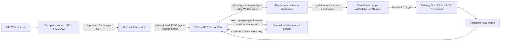

# Mission Control architecture

The existing FastAPI/HTML dashboard, ROS bridge, sensor store, watchdog, obstacle
policy and RAW10 converter were extended. No second independent dashboard, ROS
installation, boot service, replacement hardware driver or model inference stack
was introduced.

The web server binds only Pi loopback 127.0.0.1:8765. The Mac's private SSH forward
exposes it only at 127.0.0.1:8872. The ingest/model bearer token is generated into
restricted runtime files and never included in exports, URLs or source. Browser
mutations/WebSockets enforce origin checks, and untrusted Host headers are rejected.

## Components

- `dashboard/backend/ros_bridge.py`: existing ROS subscriptions, map subscriber,
  telemetry and independent ROS control timer. No hardware launch code.
- `dashboard/backend/safety.py`: arming/ownership, caps, ramping, release/deadman,
  heartbeat/disconnect/shutdown stopping and competing-publisher rejection.
- `dashboard/backend/obstacle_guard.py`: conservative directional/full-circle
  distance/coverage veto. Unknown data is never treated as free space.
- `dashboard/backend/state.py`: sensor histories, freshness and approximate capture
  alignment. Camera and ROS data remain explicitly timestamped.
- `dashboard/backend/features.py`: authenticated frame ingest, backpressured video,
  mission persistence/export, exact-frame model API and map display/export.
- `dashboard/backend/mission.py`: event persistence and v1 model-payload validation.
- `dashboard/backend/system_status.py`: read-only host CPU/RAM/temp/network telemetry.
- `dashboard/static/app.js`: reused telemetry, raw LiDAR and manual-control UI logic.
- `dashboard/static/video.js`: JPEG decode, display ACK and canvas overlay geometry.
- `dashboard/static/mission.js`: notes/POIs, history, mock-model toggle, recording,
  camera expansion and map UI. `mission.css` provides the dark field interface.
- `camera/isp_worker.c`: capture-only V4L2 queue pipeline using existing GPU devices;
  bounded buffers, latest-camera-frame drain, stop/timeout handling, exclusive lock.
- `camera/capture_worker.c`: timestamped raw capture fallback, no motor/ROS access.
- `camera/relay.py`: bounded latest-frame transport, full JPEG validation, ingest,
  backoff/reconnect and explicit raw fallback. It never sends motion commands.
- `camera/convert_raw10.py`: preserved full-resolution Mac conversion utility.
- `camera/configure.py`: explicitly approved runtime mode/exposure/gain settings.
- `scripts/missionctl.py`, `supervisor.py`, `pi_runtime.py`: Mac launcher, user-process
  supervision and ownership-aware Pi process management. Drivers are not repeatedly
  restarted. Each backend/controller starts disarmed.
- `models/example_client.py`: a clearly marked external mock, replaceable by team ML.

## Timing and frame identity

Camera helpers preserve the Pi V4L2 timestamp, mapping its monotonic clock to Pi
realtime. Each relay session adds a unique prefix to the sequence number. The Mac
clock is not substituted. Pipeline latency is measured again on the Pi at JPEG
ingest; browser ACK latency is also measured on the Pi, avoiding cross-host clock
subtraction. The hardware driver reports end-of-frame timestamps; neither measure
includes optical exposure before that point or proves glass-to-glass latency.

A dedicated reader drains the SSH stream and retains only the newest frame.
Processing, ingest and clients deliberately skip old frames. Per-client video
waits for decode acknowledgement before sending the latest image; it does not
build an unbounded queue. Source skips and relay skips are reported separately.

ROS sensor histories select the nearest header timestamp to the captured camera
frame. A capture is approximately aligned only when camera, scan and odometry are
fresh and within 250 ms. This is not hardware-triggered synchronization. ML results
refer to an exact retained JPEG and expire quickly on the live view. Pose/calibration
fields remain optional and are never fabricated.

## Separation and limits

ML contracts contain labels, confidences, normalized boxes/polygons and metadata.
They have no velocity/goal/arming output. Mock detections are amber and labeled;
real model results are still unvalidated. The current app runs no trained model.

The guard and watchdog are implemented and unit tested. Initial physical movement
remains unvalidated: an operator-authorized elevated-wheel precheck was blocked by
invalid/nearby LiDAR returns, so no motion command was issued. No autonomous motion
or exploration was attempted. Mapping UI consumes an existing grid, but SLAM Toolbox
is absent and no live SLAM result is claimed.

Camera quality follow-up: camera/metering.h supplies a tested RAW10 histogram and gray-world WB meter. The ISP worker adjusts only sensor exposure/gain and WB; unity viewing gain, one reference CCM/gamma, and fixed-quality hardware JPEG through existing /dev/video31 replace the prior 7× boost and variable video compression. No new driver or boot changes. See diagnostics/camera-quality/REPORT.md.
